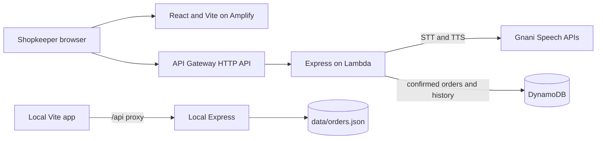

# BolBahi — Hinglish Voice Orders for Kirana Shops

Kiranas take orders in Hindi and Roman Hinglish, often with corrections while the customer is still speaking. Repeating a corrected quantity as an addition can create a wrong order. BolBahi captures the spoken order, turns it into an editable list, asks for review when details are unclear, and requires a spoken read-back and explicit confirmation before saving.

## Live demo and source

- Live demo: [BolBahi on Amplify](https://main.d2cca99agmgj8e.amplifyapp.com)
- GitHub: [aditya052003/bolbahi](https://github.com/aditya052003/bolbahi)

## Quick demo

Say **“Do kilo chawal aur ek litre tel”** → review the rice and oil lines → listen to the read-back → confirm → view the receipt in order history.

## Implemented features

- Browser microphone recording with a visible transcript from Gnani speech-to-text.
- Editable structured order lines; spoken SET corrections replace quantities, explicit ADD phrases add quantities, and removal phrases remove only the named item.
- Missing or ambiguous products, quantities, units, and unsupported wording are flagged for review rather than guessed.
- Read-back through Gnani text-to-speech; changing the order invalidates the prior read-back, and saving requires explicit confirmation.
- Receipts and saved order history. Raw audio is not saved.
- Synthetic walk-in customer data and fixed **demo prices**; totals are calculated in integer paise.

### Supported catalogue and language

| Product | Supported Hindi / Roman names | Units |
| --- | --- | --- |
| Rice | चावल, chawal, rice | kg, gram |
| Atta | आटा, atta, aata | kg, gram |
| Sugar | चीनी, chini, cheeni, शक्कर, sugar | kg, gram |
| Cooking oil | तेल, tel, oil | litre, ml |
| Milk | दूध, doodh, milk | litre, ml |
| Dal | दाल, dal, daal | kg, gram |
| Salt | नमक, namak, salt | kg, gram |
| Biscuits | बिस्किट, बिस्कुट, biscuit, biscuits | packet |

Quantities support digits and a limited set of Hindi/Roman words from zero to ten, including **aadha / आधा** (0.5), **dedh / डेढ़** (1.5), and **dhai / ढाई** (2.5). Gram and millilitre values convert to the catalogue’s kg/litre units.

Examples: **“chawal chaar kilo kar do”** sets rice to 4 kg; **“do kilo chawal aur jod do”** adds 2 kg. Correction markers such as **nahi / नहीं** apply to the following clause. The parser is deterministic and intentionally limited; it does not claim to understand unrestricted Hindi or Hinglish. The shopkeeper must click **Mark reviewed** to resolve a review flag; clarification is not automatic.

## Architecture



The deployed frontend is hosted on Amplify, the Express API runs on Lambda behind API Gateway, and confirmed deployed orders are stored in DynamoDB. Local development uses Vite and Express together and stores orders in `data/orders.json` on the app server; the browser does not use local storage for order history.

## Local setup

Use Node.js 20 or newer. In Windows PowerShell, run from the project root:

```powershell
npm.cmd ci
if (-not (Test-Path .env)) { Copy-Item .env.example .env }
npm.cmd run dev
```

Configure `GNANI_API_KEY` privately in the backend `.env` for local use. Keep an existing `.env` unchanged; only copy the example when no `.env` exists. The key is read by Express and must not be put in frontend code, Vite variables, or Git. Open [http://localhost:5173](http://localhost:5173). Microphone access requires localhost or HTTPS.

Local order data is written to `data/orders.json`; generated order data is ignored by Git. **Migration note:** earlier versions used `server/data/orders.json`. Move an existing legacy file to `data/orders.json` before upgrading; the migration is manual. The history already present in this workspace was moved byte-for-byte.

## Testing and validation

### Automated tests

```powershell
npm.cmd test
npm.cmd run build
sam validate --lint
```

The latest recorded automated run passed **25 tests** and the production Vite build; SAM template lint validation also passed. Tests cover parser corrections and additions, removals, fractions, review states, paise totals, confirmation, DynamoDB repository behavior with a fake client, and Lambda audio proxy behavior. Automated tests do not call live Gnani or AWS services.

### Isolated validation of the existing SAM artifact

The user reports that `sam build` succeeded in their normal PowerShell terminal. The existing `.aws-sam/build/BolBahiApiFunction/lambda.mjs` artifact was copied byte-for-byte to a temporary directory outside the repository and tested there, without project `node_modules` or environment files. It imported and exported `handler`; `/api/health` returned `ok: true`. The isolated test intentionally had no Gnani key, so it returned `speechConfigured: false`. It did not call DynamoDB or test live speech.

### Earlier user-reported LOCAL browser tests

These earlier browser checks were reported by the user and are not AWS verification:

- A spoken correction produced rice 4 kg and oil 1 litre, total ₹405; the confirmed order appeared in receipts and history.
- “Do packet” showed a missing-product warning without guessing an item.
- Adding two packets of biscuits produced ₹20 at the demo price.
- The user manually clicked **Mark reviewed**; the app did not resolve that clarification automatically.

### Recent user-reported DEPLOYED browser tests

These deployed checks were reported by the user and are separate from automated tests and the earlier local checks:

- Voice transcription and order review worked.
- Spoken read-back and confirmation worked.
- Receipts were saved and appeared in order history.
- The deployed health endpoint returned `ok: true` and `speechConfigured: true`.

The health result confirms configuration status only; by itself, it does not measure speech quality. The transcription and read-back results above are separate user-reported observations.

## AWS deployment

1. Create or connect the Amplify Hosting app and note its exact HTTPS branch origin. The SAM CORS setting expects the origin without a path or trailing slash.
2. From the repository root, build and deploy the backend:

```powershell
sam validate --lint
sam build
sam deploy --guided --capabilities CAPABILITY_IAM --parameter-overrides "AmplifyOrigin=https://YOUR_AMPLIFY_BRANCH_HOST"
```

3. Record the `ApiBaseUrl` stack output. In Amplify branch environment settings, set `VITE_API_BASE_URL` to that URL and rebuild the frontend.
4. In the deployed Lambda console, open **Configuration → Environment variables → Edit**, add `GNANI_API_KEY`, enter the value privately, and save. The key is configured only in the backend Lambda environment; it is not in the SAM template, deployment parameters, commands, Amplify settings, or frontend code. After every future deployment or function configuration update, verify that `GNANI_API_KEY` is still present and restore it in the console if needed.

The SAM `CodeUri` is `server/`; the project-root `.env` and local `data/` are outside the Lambda package. DynamoDB uses a conditional write to prevent duplicate receipts, and the table is retained if the stack is removed. Point-in-time recovery is disabled for this demo.

The Lambda role is limited to `GetItem` and `PutItem` on the orders table and `Query` on the history index.

<details>
<summary>Gnani speech endpoints and audio handling</summary>

| Task | Endpoint and model | Request and response |
| --- | --- | --- |
| Speech-to-text | `POST https://api.vachana.ai/stt/v3`, `prisma-v3.0` | Backend sends `X-API-Key-ID` and multipart audio with `language_code=indic-auto`, `format=codemix`, and catalogue terms. Gnani returns JSON including the transcript. |
| Text-to-speech | `POST https://api.vachana.ai/api/v1/tts/inference`, `timbre-v2.5`, voice `Poorvi`, language `hi-en` | Backend sends JSON and `X-API-Key-ID`; Gnani returns WAV audio. |

The browser converts recordings to mono 16 kHz PCM WAV before upload. It stops recording at 25 seconds. Express accepts WAV up to 30 seconds and 8 MiB locally; the Lambda deployment caps uploads and binary audio responses at 4 MiB. Audio is held in memory for processing and is not persisted.

</details>

<details>
<summary>API Gateway binary payloads and timeouts</summary>

API Gateway HTTP API v2 represents binary request bodies as base64; the Lambda adapter decodes multipart audio before Express parses it. TTS audio is returned as a base64 encoded Lambda proxy response for API Gateway to restore as audio bytes. CORS exposes `X-Readback-Token` so the browser can confirm the exact read-back.

The Lambda upload and response caps are 4 MiB. AWS documents a 10 MB HTTP API payload limit, a 30 second HTTP API integration timeout, and a 6 MB synchronous Lambda invocation request/response limit. The 4 MiB audio caps leave room for base64 expansion inside the Lambda event and response. The Gnani request timeout is 24 seconds, Lambda is configured for 28 seconds, and the API integration for 29 seconds. Over-limit or failed speech requests return errors and do not save orders.

</details>

## Limitations and future improvements

- The parser supports only the catalogue and phrase patterns listed here; unsupported or ambiguous wording needs human review.
- **Mark reviewed** is a manual shopkeeper action, not automatic clarification resolution.
- Catalogue prices are fixed demo prices and may not match a shop’s prices.
- The deployed API has no authentication or shop isolation. CORS is not authentication; add identity and per-shop data isolation before using it for real shops or customer orders.
- Customer information is synthetic (`Walk-in #104`). The app does not store raw audio.
- No performance benchmark or comprehensive language-accuracy claim is made.

Potential next steps include authentication and shop-level isolation, configurable per-shop catalogue and prices, and expanding parser coverage with more regression tests.

### Contribution disclosure

This is a solo project. The contributor supplied the product scope, shop-counter workflow, design direction, parser rules, and bug reproductions. Codex was used as an AI coding assistant for implementation, tests, and documentation.
